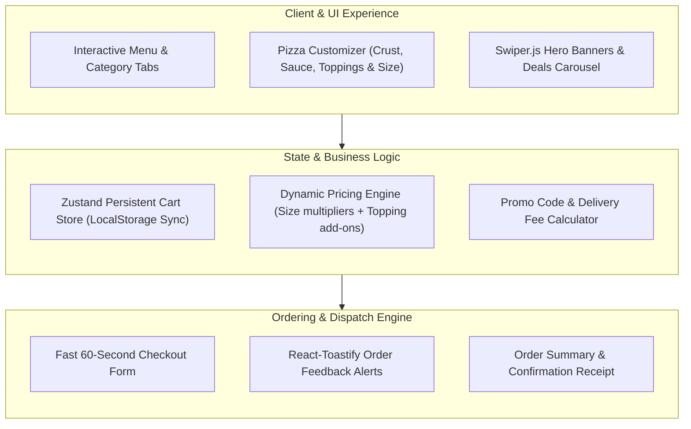

<div align="center">

<!-- Animated Header Wave Banner -->


<!-- Animated Typing SVG -->
<p align="center">
  <a href="https://pizza-lab-dv1o.vercel.app/">
    
  </a>
</p>

<!-- Tech Stack Badges -->
[](https://pizza-lab-dv1o.vercel.app/)
[](https://nextjs.org/)
[](https://react.dev/)
[](https://github.com/pmndrs/zustand)
[](https://tailwindcss.com/)
[](https://www.framer.com/motion/)
[](LICENSE)

<!-- Animated Skill Icons -->
<p align="center">
  
</p>

**[Explore Live Demo](https://pizza-lab-dv1o.vercel.app/)** • **[System Architecture](#-system-architecture)** • **[Features](#-key-features)** • **[Local Setup](#-getting-started)**

</div>

---

## 🏛️ System Architecture



---

## ✨ Key Features

### 🍕 Artisan Menu & Category Filtering
- Browse stone-baked pizzas, gourmet sides, beverages, and desserts.
- Instant category switching with smooth animated tab transitions.
- High-resolution food photography with responsive image optimization.

### 🛠️ Interactive Pizza Customizer
- Real-time selection of crust types (Classic Thin, Stuffed Crust, Pan, Gluten-Free).
- Multi-tier sauce selection (San Marzano Tomato, Creamy Garlic, Spicy Arrabiata, BBQ).
- Dynamic extra toppings (Mozzarella, Pepperoni, Mushrooms, Truffle Oil, Fresh Basil) with instant price calculation.

### 🛒 High-Performance Persistent Cart
- Powered by **Zustand** with persistent browser storage: cart items survive page reloads and browser restarts.
- Instant item count and subtotal adjustments without page re-renders.
- Dynamic delivery fee calculations, taxes, and promotional coupon code validation.

### 🌐 Bilingual RTL / LTR Experience
- Native support for Arabic (RTL) and English (LTR).
- Fluid typography, custom fonts, and culturalized number formatting.

### 📱 Mobile-First Responsive Design
- Crafted from the ground up with **Tailwind CSS v4** and **Framer Motion**.
- Touch-friendly sticky navigation, bottom cart sheets, and sub-second page transitions.

---

## 🚀 Getting Started

### Prerequisites
- Node.js 18+ (or 20+)
- npm, pnpm, or yarn

### Installation
```bash
git clone https://github.com/ga5e8je99/pizza-lab.git
cd pizza-lab
npm install
```

### Development Server
```bash
npm run dev
```

Visit [http://localhost:3000](http://localhost:3000) in your browser.

### Production Build
```bash
npm run build
npm run start
```

---

## 📄 License
This project is licensed under the MIT License.
